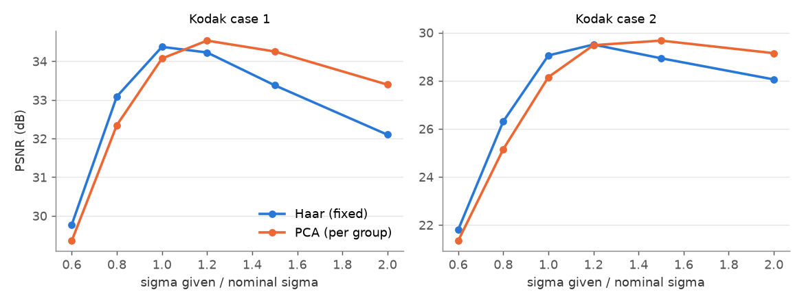
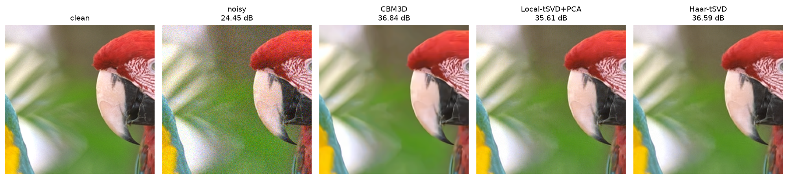
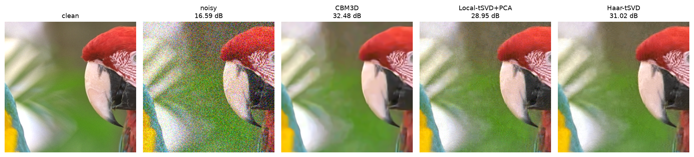
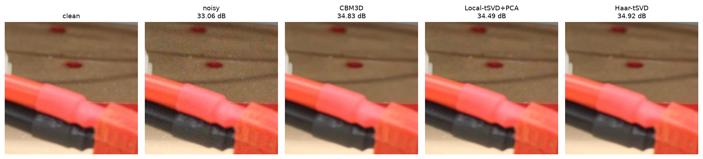

# Haar-tSVD: One-Step Image Denoising Using Haar Transform and Tensor SVD

## Final Report: Implementation, Replication and Evaluation

**Lokesh Kudipudi** — lokesh.k23@iiits.in
**Bharghava Reddy Sathi** — bharghavareddy.s23@iiits.in
**Thotham Reddy Palla** — thotamreddy.p23@iiits.in

Indian Institute of Information Technology Sri City, Chittor

> Numbers labelled "this work" in Sections 5–6 were produced on Google Colab (Tesla T4); Section 7 was produced on an RTX 3090 (see Section 7.1 for why PolyU differs between the two). The CSV files in `results/` are from the RTX 3090 run. Values labelled "reported in [22]" are copied from the paper.

---

## Abstract

This report documents our implementation of Haar-tSVD [22], a training-free, one-step image denoiser that combines one pair of globally shared t-SVD bases with a fixed Haar transform along the grouping dimension. We implemented the full pipeline (GCP patch matching, global/local/reused t-SVD bases, Haar/PCA/identity group transforms, hard thresholding, aggregation, MAD noise estimation) with NumPy, MPS and CUDA backends, and replaced the paper's CNN noise estimator by a scaled MAD estimate. On Kodak case 1 / case 2 we obtain 33.99 / 28.76 dB against 33.69 / 29.07 dB for CBM3D (the paper reports 34.13 / 29.16 dB for Haar-tSVD), so the advantage over CBM3D is reproduced at moderate noise but not at high noise. On PolyU we obtain 38.76 dB against 38.52 dB for CBM3D (paper: 38.78 dB), with σ = κ · MAD and κ = 24 tuned on ten held-out images; a per-image oracle σ gives at least 39.18 dB, and the MAD estimate fails (σ = 0) on 9 of 90 images. Shared or reused bases are as good as locally learned ones (within 0.02 dB in case 1, +0.33 dB in case 2), and with them the Haar filter stage takes 0.08 s on a 512×512 image on a T4 GPU, 3.6× faster than with local bases; the whole denoiser takes 0.89 s against 36.6 s for CPU CBM3D. With global bases, Haar beats PCA by 0.3–0.9 dB at our shared threshold scale, but this is mostly calibration: with its own best σ, PCA is 0.17 dB ahead, and Haar degrades faster when σ is overestimated. A σ floor tuned on validation adds 0.37 dB on PolyU, mostly from images where MAD = 0, while the PCA estimator of Chen et al. gives no further gain. On SIDD validation we obtain 33.56 dB against 33.31 dB for CBM3D, both about 1.5 dB below the values reported in [22]. We conclude that the fixed Haar transform and shared bases hold up, and that the weak point of a blind pipeline without the CNN is setting σ on real noise.

---

## 1. Introduction

This project studies training-free, one-step image denoising through Haar-tSVD [22]. We (i) implemented the method, (ii) replaced the paper's CNN noise estimator by classical ones, (iii) ran the Kodak and PolyU experiments and the ablations that answer RQ1–RQ3, (iv) compared noise estimators and validated on SIDD, and (v) reviewed the literature on noise-level estimation, real-noise modelling and zero-shot denoisers (Section 3).

Section 2 states the problem and research questions, Section 3 reviews the literature, Section 4 describes the implementation and deviations from the paper, Section 5 replicates results reported in [22], Section 6 gives our own results, Section 7 evaluates noise estimators and SIDD, Section 8 discusses the gaps, Section 9 concludes, and Section 10 lists future work.

---

## 2. Problem and Research Questions

Given a noisy colour image Y = X + N, where N is zero-mean noise with standard deviation σ (white Gaussian for synthetic data, an effective level for real camera noise), the task is to estimate the clean image X, measured by PSNR and SSIM. The denoiser must be *one-step* (each group of similar patches gets a single forward transform, threshold and inverse transform, with no iterative optimisation) and *training-free* (no paired data, no network training and no per-group basis learning). The full formal statement is Section 2 of the preliminary report. The research questions are:

- **RQ1:** Can a fixed Haar transform replace per-group PCA without a noticeable loss in PSNR/SSIM?
- **RQ2:** Can one set of t-SVD bases, learned once, be shared across all patches (and reused across images)?
- **RQ3:** How much faster is the resulting one-step filter than methods that learn local bases or solve iterative problems?

The adaptive variants of [22] (A-Haar-tSVD with a CNN noise estimator, RA-Haar-tSVD with a fully connected network) are outside the required scope; the CNN estimator is replaced by a classical one (Section 4.2).

---

## 3. Literature Review

### 3.1 Noise-level estimation (replacing the paper's CNN)

Haar-tSVD takes σ as an input: it sets the hard threshold τ. The paper obtains σ for real images from a CNN classifier over discrete levels (Fig. 5 and Table II of [22]), whose accuracy on real data is only 69–75 %. Our training-free scope needs a classical estimator.

**Donoho and Johnstone [8]** estimate σ from the median absolute deviation (MAD) of the finest wavelet detail band, σ̂ = median(|d − median(d)|)/0.6745. This is what we use: `estimate_sigma` applies it to the diagonal (HH) band of a non-overlapping 2×2 orthonormal Haar transform, per colour channel, and averages the three values. It is cheap and has no parameters, but it assumes the noise is white and that most finest-scale coefficients contain only noise, so it is biased by image edges (upwards) and by spatially correlated noise (downwards).

**Liu, Tanaka and Okutomi [37]** pick weak-texture patches using gradient-covariance statistics and estimate σ by PCA on those patches (the smallest eigenvalue of the patch covariance), iterating the selection with the current σ. They also argue that the best σ to give a non-blind denoiser is not always the true σ and should depend on scene complexity, which supports tuning a multiplier on our estimate (our κ, Section 4).

**Pyatykh, Hesser and Zheng [38]** show that, for block-based PCA, the noise variance can be read from the smallest eigenvalue of the block covariance. **Chen, Zhu and Heng [39]** observe that this underestimates σ and correct it by a statistical analysis of the eigenvalues of the redundant dimensions, selecting the redundant subspace by a model-selection argument; the paper also reports that BM3D achieves optimal performance with their estimate. This is the alternative to MAD that we evaluate in Section 7.2, since it is closed-form and training-free.

*Why MAD underestimates real sRGB noise (our reasoning; the oracle results of Section 6.2 are consistent with it but do not prove it).* Camera noise in sRGB images passes through demosaicking, white balance and JPEG, which make it spatially and cross-channel correlated [42]. Correlated noise carries most of its energy at low and mid frequencies, so the finest wavelet band sees less than the total noise variance and MAD returns a σ̂ below the σ that the thresholds need. A multiplicative correction κ > 1 on σ̂ compensates for this on average, which is why we tune κ on PolyU (Section 6). The PolyU inputs are JPEG files, and quantisation in JPEG plausibly removes even more of the finest-band energy.

### 3.2 Real-noise modelling

**Foi, Trimeche, Katkovnik and Egiazarian [40]** model raw sensor noise as Poissonian–Gaussian: the variance is affine in the underlying signal (a·x + b), and they give a method to fit a and b from a single image. Real sRGB images violate even this model because of the camera pipeline, but it explains why noise strength depends on brightness.

**Mäkitalo and Foi [41]** handle Poisson–Gaussian noise by a three-step scheme: apply the generalised Anscombe transformation (GAT) so that the noise becomes approximately Gaussian with unit variance, denoise with a Gaussian denoiser (they use BM3D), and apply an inverse. Their contribution is a properly unbiased inverse, because the naive algebraic inverse is biased at low counts. The relevance for us is that Haar-tSVD is a Gaussian-noise denoiser, so a VST front end is a natural route to signal-dependent noise.

**Camera-pipeline effects.** Nam et al. [42] model cross-channel noise correlation in real images. Eq. (12) of [22], the argument that noise adds σ²I to the Fourier-domain correlation matrices so the t-SVD bases are preserved, needs white noise. With correlated noise the added term is no longer a multiple of the identity, which in principle perturbs the learned bases. The paper's Table I (clean vs. noisy bases on CC15, HighISO, SIDD) suggests the effect is small in practice. The green-channel prior in the matching step [21] is a pragmatic response to the unequal per-channel noise.

### 3.3 GCP-ID and MSt-SVD in detail

**MSt-SVD (Kong and Yang [19]).** A one-step t-SVD denoiser built on a block-diagonal representation of a patch group. For every group it *learns* local bases (a t-SVD pair along the patch dimensions and a PCA-type transform along the group dimension), so the cost is dominated by per-group decompositions.

**GCP-ID (Kong, Deng and Yang [21]).** Adds the green-channel prior: patches are matched mainly on the less noisy green channel (our Eq. (9)-style matching, γ = 1.2), and a CNN estimates the noise level, making the method adaptive. Its filter is still PCA-tSVD with local bases. In the paper's Table III it is parallel, one-step and adaptive, but has no global transform.

**What changes in Haar-tSVD [22].** (i) The patch-level bases (U, V) are learned *once* from all reference patches, or reused from another image, instead of per group. (ii) The group-level PCA is replaced by the fixed Haar matrix, justified by the fact that the dominant eigenvector of the circulant Gram matrix is the constant vector (Eq. (18) of [22]), which equals the first Haar row for K a power of two. (iii) The matching step and the t-SVD machinery are inherited from GCP-ID/MSt-SVD. We therefore use Local-tSVD+PCA (local bases, PCA group transform) as the stand-in for MSt-SVD in our comparison, and say so explicitly.

### 3.4 Zero-shot and self-supervised denoisers used as baselines in [22]

Table IV of [22] compares against several methods that need no clean targets; we add ZS-N2N, which [22] does not include, as a representative zero-shot baseline. They are positioned against our setting, "no paired data and no optimisation at all", as follows.

- **ZS-N2N (Mansour and Heckel [43]).** A 2-layer convolutional network (about 20k parameters) is trained from scratch on the single noisy test image, using two down-sampled versions of it as a Noise2Noise-style pair plus a consistency loss. It needs no noise model and runs on a CPU, but assumes pixel-wise independent noise and still performs per-image optimisation. It is not among the baselines of [22].
- **Noise2VST (Herbreteau and Unser [44]).** Learns a model-free variance-stabilising transform, a piecewise-linear function whose parameters are fitted with a self-supervised loss on the noisy image alone, so that an off-the-shelf Gaussian denoiser can be applied to real noise. It is conceptually the closest to a VST-based extension of this work (Section 10), but it depends on a pretrained Gaussian denoiser and optimises per image.
- **Pixel2Pixel (Ma et al. [45]).** For every pixel it collects the most similar pixels from a surrounding region into a pixel bank and samples from it to form many noisy versions of the image with the same signal and independent noise, which are used to train a compact network on the single test image. It needs no noise model, but optimises per image.
- **Blind2Unblind (Wang et al. [27]).** Self-supervised, uses blind spots made visible by a masking scheme and is trained on a set of noisy images, so it needs data but no clean targets. In [22] it reaches 29.91 dB on Kodak case 1 and 38.25 dB on PolyU, against 34.13 and 38.78 for Haar-tSVD (as reported in [22]).

The observation from Table IV of [22] is that most of these methods are weak on the synthetic channel-wise noise of Kodak case 1 (Pixel2Pixel 30.26 dB, Blind2Unblind 29.91 dB, against 34.13 dB for Haar-tSVD, all as reported in [22]); the exception is Noise2VST at 34.08 dB, which is on par with Haar-tSVD there but falls to 28.34 dB on case 2 against 29.16 dB. A plausible reason for the weak ones is that the noise is channel-wise and not pixel-wise independent, so their noise assumptions or training distribution do not match. This is our interpretation, not a claim made in [22].

### 3.5 Evaluation protocols

- **SIDD [1].** We use the validation split (`ValidationNoisyBlocksSrgb.mat`) with the matching ground-truth blocks. Numbers from the SIDD benchmark server and the validation split are not directly comparable, and [22] mixes both sources (asterisked entries in its Table IV).
- **DND [23].** Ground truth is withheld; results come from the benchmark's online server, so we can only report what the server returns after a submission.
- **SSIM.** Variants differ: luminance-only SSIM vs. per-channel SSIM averaged over R, G, B. The authors' code averages per-channel SSIM, and so do we, so our SSIM values are comparable to [22] but not necessarily to papers that use luminance SSIM.

### 3.6 Comparison table

**Table 3.** Comparison of the methods discussed above. "Training" means any data-driven or per-image optimisation at test time. Entries for [22] follow its Table III and Section III.

| Method | Needs training? | Iterative at test time? | Group-level transform | Noise-level estimate |
|---|---|---|---|---|
| BM3D / CBM3D [6, 7] | No | No (two stages) | Fixed 3D transform | Given σ |
| MSt-SVD [19] | No | No | Learned per group | Given σ |
| GCP-ID [21] | CNN estimator only | No | Learned per group (PCA) | CNN classifier |
| **Haar-tSVD [22] (paper)** | No | No | Fixed Haar | Given σ |
| A-Haar-tSVD [22] | CNN estimator | No | Fixed Haar | CNN + eigenvalue rank adjustment |
| **Haar-tSVD (this work)** | No | No | Fixed Haar | MAD × κ |
| ZS-N2N [43] | Per-image network training | Yes (gradient descent) | – | Blind (none) |
| Pixel2Pixel [45] | Per-image optimisation | Yes | – | Blind |
| Noise2VST [44] | Calibrates a VST per image; pretrained Gaussian denoiser | Yes | – | Self-calibrated |
| Blind2Unblind [27] | Yes (noisy image set) | No at test | – | Blind |
| DnCNN [32] / FFDNet [33] | Yes (paired) | No | – | None / noise map |

---

## 4. Implementation

### 4.1 Pipeline as built

The package `haartsvd/` implements Algorithm 1 of [22]: (1) GCP matching of K similar patches inside a search window (matching rule of Eq. (9) in [22], γ = 1.2); (2) a pair of global t-SVD bases (U, V), learned from all reference patches, from local groups, or reused from another image; (3) a group-level transform (Haar, PCA or identity); (4) hard thresholding (Eq. (20) of [22]); (5) inverse transforms and averaging aggregation. Noise levels come from the MAD estimator unless an oracle σ is given. Defaults follow the paper: ps = 8, K = 32. The reference patches lie on a grid with stride 4 and each group is searched in a (2·20+1)² = 41×41 window. The matching rule (`gcp`, `avg` or `green`), the group transform (`haar`, `pca`, `none`), the basis source (`global`, `local`, `reused`) and the aggregation weights (`uniform` as in the paper, or `sparse`, i.e. 1 / number of non-zero coefficients) are all parameters, which is what the ablations vary. The filter is a single stage: there is no second Wiener-type stage as in CBM3D. The global bases are the eigenvectors of the (uncentred) row and column correlation matrices of the Fourier-domain reference patches, learned from the noisy image; the slices that are their own conjugate (the DC slice for c = 3) keep real bases so that the whole projection is a real orthogonal map. The reference grid always includes the last row and column, so every pixel is covered by at least one group.

### 4.2 Design choices and deviations from the paper

1. **Orthonormal channel FFT and the threshold scale.** The paper sets τ = σ√(2 log(c·K·ps²)) with c = 3 for colour images. For ps = 8, K = 32 this is τ ≈ 4.18σ. Our channel FFT is orthonormal, so noise keeps variance σ² in every coefficient. If the authors' MATLAB code uses an unnormalised `fft` along the channel mode, its coefficients are √3 larger, which would make the same τ equivalent to about 4.18σ/√3 ≈ 2.41σ in our units; this is a hypothesis that we have not checked against their code. We instead multiply τ by `TAU_SCALE = 0.45` (about 1.88σ), chosen empirically. For comparison, the first-stage hard threshold of BM3D is usually set to about 2.7σ [6]. The scale was tuned on two images (kodim01 and kodim13) and fixed for all other experiments.
2. **Search parameters.** Search radius 20 (a 41×41 window) and step 4, taken from the authors' public code. The paper says only "W < 20" and uses W = 18 in its parameter study; we have not established whether the paper's W is a radius or a window width, so the two are not necessarily the same quantity.
3. **Noise estimation.** MAD × κ replaces the CNN estimator. κ is a single global constant chosen on PolyU (Section 6.2); Kodak uses σ = 20 (case 1) and σ = 50 (case 2), as in [22].

### 4.3 Backends

| Backend | Used for | Notes |
|---|---|---|
| NumPy (`device="numpy"`) | Reference for all variants; also the automatic fallback on MPS for local bases or PCA | Slowest; used as ground truth for correctness checks |
| Torch real-form (MPS / CUDA / CPU) | Shared bases (global or reused) with Haar or identity group transform | The channel FFT combined with the slice-wise transforms is written as one orthogonal 192×192 real matrix (3·ps² = 192), so the forward transform is a batched matrix multiply. Complex coefficients are stored as (√2·Re, √2·Im) pairs and thresholded on their joint magnitude, which is the same rule as on the NumPy path; the code checks that the matrix is orthogonal (error < 1e-6) |
| Torch complex (CUDA / CPU) | Local bases or PCA group transform | Needs complex tensors, which MPS lacks, so on MPS these variants run on the NumPy path |
| Block matching | All variants | Torch on CUDA, Numba on CPU and MPS (`matcher="auto"`), so "NumPy" timings use a Numba matcher |

On MPS the output matches the NumPy reference in PSNR, and the filter stage takes 0.42 s against 2.97 s on kodim01 (from our development notes; we did not rerun on MPS, and the measured CUDA and CPU timings are in Section 6.3). The CUDA path was checked on Colab (Tesla T4): `check_device.py` printed OK, and for the four variants it tests (global bases + Haar, local bases, PCA group transform, local bases + PCA) the PSNR difference between the CUDA and the NumPy result is at most 0.0002 dB, with both the Numba and the torch block matcher.

### 4.4 Hardware and seeds

Hardware for Sections 5–6: Google Colab, NVIDIA Tesla T4 (15 GB, driver 580.82.07, CUDA 13.0) and an Intel Xeon CPU @ 2.00 GHz; torch 2.11.0+cu130, numba 0.61.2, numpy 2.1.3, scikit-image 0.25.2, bm3d 4.0.3. No MPS runs were made. Kodak noise seed: 1000·case + image index (0-based, over all 24 images), so every run reproduces the same noisy images. The ablations use the same rule but with the index *within the six-image subset*, so their noisy realisations differ from those of the main Kodak run; the "reused" bases are learned from noisy kodim01 with seed 7. Run `scripts/run_all.sh` to regenerate every table.

Evaluation details. Kodak noisy images are float arrays that are neither clipped nor rounded to 8 bits, so the noise is exactly Gaussian. Outputs are clipped to [0, 255] before PSNR (peak 255) and SSIM. SSIM is the scikit-image implementation with a Gaussian window (σ = 1.5, no sample covariance), averaged over the R, G, B channels. PolyU uses `*_real.JPG` as the noisy input and `*_mean.JPG` as the reference. The GPU filter accumulates in float32 with atomic additions, so results can differ in the last digits between runs and from the float64 NumPy path.

---

## 5. Results Replicated from the Literature

Each table puts the numbers *reported in [22]* beside *this work*.

### 5.1 Paper Table IV: Kodak and PolyU

*Source of "this work": `results/kodak_summary.csv`, `results/polyu_summary.csv`. "Local-tSVD+PCA" is our stand-in for MSt-SVD (local bases + PCA group transform, no Haar), as discussed in Section 3.3. CBM3D is the Python `bm3d` package (`bm3d_rgb`, which we run with σ/255 on a [0,1] image), not the MATLAB CBM3D used in [22], so small differences from the paper's CBM3D numbers are expected.*

| Method | Kodak-1 [22] | Kodak-1 (this work) | Kodak-2 [22] | Kodak-2 (this work) | PolyU [22] | PolyU (this work) |
|---|---|---|---|---|---|---|
| CBM3D | 33.51 / .893 | 33.69 / .895 | 28.90 / .780 | 29.07 / .782 | 38.69 / .970 | 38.52 / .967 |
| MSt-SVD / Local-tSVD+PCA | 33.99 / .906 | 33.57 / .888 | 29.12 / .770 | 27.44 / .653 | 38.85 / .971 | 38.27 / .964 |
| Haar-tSVD | 34.13 / .910 | 33.99 / .906 | 29.16 / .780 | 28.76 / .741 | 38.78 / .969 | 38.76 / .967 |

Kodak columns: all 24 images, from `kodak_summary.csv` (n = 24 per row; 144 rows in `kodak_per_image.csv`). PolyU test set: the 90 images that remain after the first 10 are used to choose κ (see 6.2).

**Kodak results.**

- *Case 1.* Haar-tSVD reaches 33.99 dB / 0.906, which is 0.14 dB below the 34.13 dB reported in [22] and 0.30 dB above our CBM3D (33.69 dB). The margin over CBM3D is smaller than in [22] (0.62 dB) because our CBM3D is 0.18 dB above the value reported there. Haar-tSVD is better than CBM3D in PSNR on 18 of 24 images and in SSIM on 19 of 24; the largest gain is 0.75 dB (kodim01) and the largest loss 0.36 dB (kodim07).
- *Case 2.* Haar-tSVD reaches 28.76 dB / 0.741 against 29.16 dB / 0.780 reported in [22] (−0.40 dB), and our CBM3D reaches 29.07 dB / 0.782. The ordering reported in [22] (Haar-tSVD 0.26 dB above CBM3D) is therefore **not reproduced**: Haar-tSVD is 0.31 dB below CBM3D, better on only 7 of 24 images in PSNR and 4 of 24 in SSIM. CBM3D leads by up to 1.47 dB (kodim23), while Haar-tSVD leads by up to 0.82 dB (kodim13, a highly textured image). The SSIM gap (0.741 against 0.782) is larger than the PSNR gap suggests; a possible reason is residual noise in smooth regions, since our filter has a single stage and CBM3D adds a Wiener stage. We have not tested this.
- *Local-tSVD+PCA stand-in.* It scores 33.57 dB (case 1) and 27.44 dB (case 2), which is 0.42 dB and 1.68 dB below the values reported for MSt-SVD in [22]. It is therefore weaker than the published MSt-SVD, especially at high noise, so it should be read as "local bases + PCA in our implementation" and not as a faithful reproduction of MSt-SVD. One possible reason is that `TAU_SCALE = 0.45` was tuned for global bases with the Haar transform and is not suited to local PCA bases; we have not tested this.
- *Run time on Kodak (512×768 images; Colab Tesla T4 and Xeon CPU).* Mean per image after discarding the first image, which includes GPU warm-up: Haar-tSVD 1.41 s (case 1) and 1.44 s (case 2), Local-tSVD+PCA 1.15 s and 1.20 s, CBM3D (Python `bm3d` package on the CPU) 54.4 s and 58.1 s. Haar-tSVD runs on the GPU and CBM3D on the CPU, so these times are not like-for-like.

*σ convention on Kodak.* As in [22], every denoiser, including CBM3D, receives a single σ = 20 (case 1) and σ = 50 (case 2), although the true channel standard deviations are (15, 10, 20) and (40, 30, 50). These σ equal the largest channel std. The RMS noise level is √((15²+10²+20²)/3) ≈ 15.5 for case 1 and ≈ 40.8 for case 2, so the given σ is about 29 % and 22 % above the RMS value. `TAU_SCALE` was tuned under this convention.

### 5.2 Paper Table I: locally learned, globally learned and reused bases

*[22] reports this on CC15, HighISO and SIDD-val, where we did not repeat this comparison; we repeat the comparison on a six-image Kodak subset (kodim03, 05, 08, 15, 19, 23) for both noise cases from `results/ablation_transforms.csv` (group = haar; bases = local / global / reused), so only the trend is comparable. Our "reused" bases are learned from one noisy image (kodim01) at the same noise case, so the noise level matches, unlike a transfer across datasets.*

Reported in [22]: CC15 37.86 / 37.89 / 37.90 dB (local / global / reused), HighISO 40.05 / 40.13 / 40.15, SIDD-val 34.35 / 34.39 / 34.38; time 6.95 s / 6.13 s / 6.02 s.

This work (group = haar, six-image subset, PSNR / SSIM, mean time per 512×768 image on the T4):

| Bases | Case 1 | Case 2 | Time (s), case 1 / 2 |
|---|---|---|---|
| Local | 34.38 / 0.9138 | 28.72 / 0.7364 | 0.90 / 0.90 |
| Global | 34.37 / 0.9163 | 29.05 / 0.7622 | 1.47 / 1.30 |
| Reused (from kodim01) | 34.39 / 0.9167 | 29.06 / 0.7625 | 0.61 / 0.61 |

Sharing bases costs nothing in PSNR: in case 1 the three variants are within 0.02 dB, and in case 2 global and reused bases are 0.33–0.34 dB *better* than local bases, with SSIM higher by 0.026. This agrees with the trend in [22], where shared bases are equal or slightly better (+0.03 to +0.10 dB). Bases learned once from a different image (kodim01) work as well as bases learned from the image itself. The speed result differs from [22], where global bases are faster than local ones (6.13 s against 6.95 s). On our GPU path, global bases are *slower* in total (1.47 s against 0.90 s per image), because learning the global bases is a separate step (0.46 s on a 512×512 image, Section 6.3), while local bases are computed inside the batched filter. Reusing bases removes that step and is the fastest variant (0.61 s). The time column of the ablation includes the first-image warm-up of each variant, so Section 6.3 is the cleaner timing source.

### 5.3 Paper Fig. 6: sensitivity to a wrong σ, Haar vs. PCA

[22] states that Haar-tSVD matches PCA-tSVD in quality but is more sensitive to the noise level and tends to over-smooth when σ is mis-specified (the figure plots PSNR against σ from 15 to 55; the paper gives no table).

This work: `results/ablation_sigma.csv` and `results/figures/sigma_sensitivity.png`. Design: the σ passed to the denoiser is a factor f ∈ {0.6, 0.8, 1.0, 1.2, 1.5, 2.0} times the nominal σ (20 for case 1, 50 for case 2), for the Haar and the PCA group transform, both with global bases, on the six-image subset. This differs from [22], whose PCA-tSVD baseline has its own (local) bases and whose x-axis is the absolute σ. We had expected the best factor to be below 1, because the nominal σ is above the RMS noise (Section 5.1). It is not: `TAU_SCALE` was tuned at f = 1 under the same convention, which already absorbs that offset. Drops are therefore measured from each curve's own maximum.

| PSNR (drop from own peak) | f = 0.6 | 0.8 | 1.0 | 1.2 | 1.5 | 2.0 |
|---|---|---|---|---|---|---|
| Haar, case 1 | 29.77 (−4.60) | 33.09 (−1.28) | **34.37** | 34.23 (−0.14) | 33.38 (−0.99) | 32.10 (−2.27) |
| PCA, case 1 | 29.35 (−5.19) | 32.35 (−2.19) | 34.07 (−0.47) | **34.54** | 34.25 (−0.29) | 33.40 (−1.14) |
| Haar, case 2 | 21.80 (−7.70) | 26.31 (−3.19) | 29.05 (−0.45) | **29.50** | 28.93 (−0.57) | 28.05 (−1.45) |
| PCA, case 2 | 21.34 (−8.33) | 25.15 (−4.52) | 28.15 (−1.52) | 29.48 (−0.19) | **29.67** | 29.14 (−0.53) |

Three observations.

1. **Both transforms are far more sensitive to an underestimated σ than to an overestimated one.** At f = 0.6 every curve loses 4.6–8.3 dB, and at f = 2.0 it loses 0.5–2.3 dB.
2. **The two curves peak at different factors.** Haar peaks at f = 1.0 (case 1) and 1.2 (case 2), PCA at 1.2 and 1.5. With the same `TAU_SCALE`, PCA needs a larger σ, so a comparison at f = 1 favours Haar by construction.
3. **The overestimation side matches the claim in [22].** Haar is the more sensitive transform when σ is overestimated: at f = 2.0 it is 2.27 dB (case 1) and 1.45 dB (case 2) below its peak, against 1.14 and 0.53 dB for PCA. This is the over-smoothing that [22] describes, and it fits the PolyU images where Local-tSVD+PCA beat Haar-tSVD at a large σ (Section 6.2). Part of this difference comes from the different peak positions (f = 2.0 is 1.7–2 times Haar's best factor but only 1.3–1.7 times PCA's), and the grid is too coarse to remove that effect.

In case 2 the Haar SSIM rises from 0.762 at f = 1.0 to 0.816 at f = 1.2. This supports the explanation in Section 5.1 that our case-2 outputs keep residual noise, and suggests that a single `TAU_SCALE` is too low for case 2 (Section 7).

---

## 6. Results of Our Own

### 6.1 RQ1 and RQ2: Haar vs. PCA, and basis sharing

Source: `results/ablation_transforms.csv`. Table: group transform (haar / pca / identity) × bases (local / global / reused; identity only with global), for both noise cases, on the six-image subset, with PSNR, SSIM and time. All variants use the same `TAU_SCALE = 0.45`, which was tuned for global bases with Haar, so the PCA and local variants are not individually tuned and may be slightly disadvantaged.

| PSNR / SSIM | Haar | PCA | Identity |
|---|---|---|---|
| Case 1, local bases | 34.38 / 0.9138 | 33.94 / 0.8965 | – |
| Case 1, global bases | 34.37 / 0.9163 | 34.07 / 0.9021 | 33.72 / 0.9056 |
| Case 1, reused bases | 34.39 / 0.9167 | 34.11 / 0.9031 | – |
| Case 2, local bases | 28.72 / 0.7364 | 27.64 / 0.6700 | – |
| Case 2, global bases | 29.05 / 0.7622 | 28.15 / 0.7005 | 27.84 / 0.7255 |
| Case 2, reused bases | 29.06 / 0.7625 | 28.18 / 0.7014 | – |

**RQ1 (Haar vs. PCA).** At the shared `TAU_SCALE`, Haar beats PCA in every row: by 0.44 / 1.08 dB with local bases and 0.30 / 0.90 dB with global bases (case 1 / case 2). It also beats no group transform at all (identity) by 0.65 / 1.21 dB. However, Section 5.3 shows that PCA peaks at a larger σ. When each transform gets its best factor from the grid, PCA with global bases is 0.17 dB *ahead* in both cases (34.54 against 34.37, and 29.67 against 29.50). Most of the Haar advantage in this table therefore comes from the threshold calibration, which was tuned for Haar. With equal tuning, the two transforms are within about 0.2 dB, which is close to the claim in [22] that Haar matches PCA in quality. Haar keeps its other advantage: it is a fixed transform with no per-group eigen-decomposition, and on our GPU its filter stage takes 0.08 s against 0.32 s for PCA (Section 6.3). The same calibration effect probably explains why our local-bases + PCA stand-in for MSt-SVD is weak on Kodak (Section 5.1), but we did not run a σ sweep for that variant.

**RQ2 (basis sharing).** See Section 5.2: local, global and reused bases are within 0.02 dB in case 1, and shared bases are 0.33 dB better in case 2. The same holds with PCA (global and reused are 0.13–0.54 dB above local). Sharing bases does not cost PSNR.

### 6.2 PolyU: κ tuning and the oracle-σ gap

Source: `results/polyu_kappa_tuning.csv`, `polyu_per_image.csv`, `polyu_summary.csv`. Protocol: σ = κ · MAD; κ is chosen on the first 10 PolyU images (validation) by Haar-tSVD PSNR, and results are reported on the other 90 images (test).

*κ search.* The planned grid {1.0, 1.5, …, 4.0} chose its upper edge (validation PSNR rose monotonically from 35.37 to 35.61 dB), so we widened it twice, as planned: {2, 3, 4, 5, 6, 8, 10, 12} again chose its edge (36.30 dB at κ = 12), and {8, 10, 12, 14, 16, 20, 24} gives 36.01, 36.17, 36.30, 36.39, 36.45, 36.52, 36.53 dB. The last grid again picks its edge, κ = 24, but the curve has flattened (+0.01 dB from 20 to 24), so we stop there and report κ = 24. Test-set Haar-tSVD PSNR was 36.70 dB with κ = 4, 38.24 dB with κ = 12 and 38.76 dB with κ = 24.

| (90 test images) | PSNR | SSIM | time (s) |
|---|---|---|---|
| Noisy input | 36.04 | – | – |
| Local-tSVD+PCA, σ = 24 · MAD | 38.27 | 0.9635 | 0.71 |
| Haar-tSVD, σ = 24 · MAD | 38.76 | 0.9670 | 0.88 |
| Haar-tSVD, oracle σ ∈ {2, …, 15} | 39.01 | 0.9706 | – |

*The MAD estimate barely varies across images.* The 8-bit HH coefficients take values on a 0.5 grid, so the per-channel median takes only a few values; for 73 of the 90 test images the channel-averaged MAD is 0.74 (= 0.5 / 0.6745), giving σ = 17.79. Nine images get MAD = 0 (σ = 0, so neither method changes them; they are the ties in the per-image comparison), and the remaining eight get σ ∈ {5.93, 11.86, 29.65, 35.58}. In practice, σ = κ · MAD therefore acts as one global σ ≈ 17.8 tuned on ten images, not as a per-image noise estimate. The κ ≈ 24 needed shows how far the finest-scale MAD is below the σ that works best for the denoiser. As the `polyu.py` header notes, real sRGB noise is spatially correlated, and the finest diagonal band captures only part of it; the value also absorbs `TAU_SCALE` (Section 4.2). Both explanations are hypotheses we have not separated. The paper uses a learned noise estimator instead [22].

*Comparison.* With this protocol Haar-tSVD reaches 38.76 dB / 0.967, within 0.02 dB of the 38.78 dB reported in [22], and is above Local-tSVD+PCA on 71 of the 81 images it changes. Local-tSVD+PCA is better on 10 images, including all four images that get σ ≥ 29.65 and four of the five Canon5D2 "toy" scenes, which suggests (untested) that the Haar variant smooths more when σ is set high.

Four caveats for the table. (i) The same σ = κ · MAD is given to Local-tSVD+PCA, although κ was tuned for Haar-tSVD (with its own `TAU_SCALE`), so the baselines are not tuned. (ii) "Oracle σ" is the best of nine values {2, 3, 4, 5, 6, 8, 10, 12, 15}, chosen per image using the ground truth, so it is an upper bound that also absorbs per-image tuning, not the true noise level. Oracle-σ gap: oracle − estimated = 39.01 − 38.76 = 0.25 dB. (iii) The oracle grid stops at 15, but the estimated σ is 17.79 on most images, so this "oracle" does not search the region the tuned estimator uses, and 0.25 dB is a lower bound on the true gap. We therefore extended the oracle with σ ∈ {18, 20, 24, 28, 32} (`polyu_oracle_ext.csv`). The extended oracle reaches 39.18 dB / 0.9717, and the best σ is above 15 on 77 of the 90 images, so the gap to the estimated-σ result is 0.42 dB. Even this is a lower bound, because 16 images still pick the new largest value, σ = 32. More than half of the gap comes from the nine images where MAD = 0: we leave them unchanged (39.03 dB on average), while the oracle denoises them to 41.49 dB (+2.45 dB). These images are therefore noisy, and a zero MAD is a failure of the estimator, not a sign of clean input. Averaged over all 90 images they account for 0.25 dB of the 0.42 dB gap, while the other 81 images are 0.20 dB from their oracle. A lower bound on σ would remove most of this loss. We did not apply one here, because we found the problem using the test-set oracle, so tuning on it would leak test information. Section 7.2 tunes it on the validation images only. (iv) CBM3D on PolyU is run separately with its own κ tuned on the same 10 validation images (`polyu_extra.py`), so caveat (i) does not apply to it. Its validation grid {8, 12, 16, 24, 32} gives 36.06, 36.32, 36.43, 36.43, 36.35 dB, an interior peak, and the first maximum, κ = 16 (σ = 11.86 for most images), is used. On the test set CBM3D reaches 38.52 dB / 0.9668, i.e. 0.17 dB below the 38.69 dB reported in [22], and 0.24 dB below our Haar-tSVD (38.76 / 0.9670). On the 81 images that get σ > 0, Haar-tSVD has the higher PSNR on 73 and the higher SSIM on 47, so the PSNR advantage is consistent but the SSIM values are practically equal. CBM3D wins on the Canon5D2 "toy" scenes (by up to 0.34 dB), as Local-tSVD+PCA did. The nine images with MAD = 0 are returned unchanged by CBM3D as well (`bm3d` cannot run with σ = 0), so they do not favour either method. With this protocol the ordering on PolyU is Haar-tSVD > CBM3D > Local-tSVD+PCA (38.76 > 38.52 > 38.27 dB), whereas [22] reports MSt-SVD > Haar-tSVD > CBM3D (38.85 > 38.78 > 38.69 dB); the Haar-tSVD vs CBM3D order agrees. CBM3D time on PolyU (72 s per 512×512 image) was measured with two images processed in parallel, one thread each, so it is not comparable to the Kodak CBM3D times and is not reported in the tables.

### 6.3 RQ3: speed

Source: `results/timing.csv`. Image: a 512×512×3 crop of kodim23 (case 1 noise, σ = 20); each row is the mean of three runs after one warm-up run. Rows: Haar-tSVD (global bases) on the auto-selected device, on the torch CPU path and on NumPy; global bases + PCA; local bases + Haar; local bases + PCA. The columns are `search`, `bases`, `filter`, `aggregate`, `total`. On the torch paths the filter and aggregation steps are fused, so their time is stored in the `filter` column and `aggregate` is empty; separate filter and aggregate times exist only for the NumPy path. CBM3D (Python `bm3d` package, CPU) is a single run.

| Method (512×512×3, σ = 20) | Device | Search | Bases | Filter (+ aggregate) | Total (s) |
|---|---|---|---|---|---|
| Haar-tSVD, global bases | CUDA (T4) | 0.36 | 0.46 | 0.08 | **0.89** |
| Haar-tSVD, global bases | torch CPU | 4.62 | 0.46 | 5.65 | 10.73 |
| Haar-tSVD, global bases | NumPy CPU (Numba matcher) | 4.76 | 0.46 | 9.19 + 1.24 | 15.65 |
| Global t-SVD + PCA | CUDA | 0.35 | 0.46 | 0.32 | 1.13 |
| Local t-SVD + Haar | CUDA | 0.35 | (in filter) | 0.29 | 0.64 |
| Local t-SVD + PCA | CUDA | 0.35 | (in filter) | 0.41 | 0.76 |
| CBM3D (`bm3d` package) | CPU | – | – | – | 36.55 |

- **GPU against CPU.** On the GPU Haar-tSVD takes 0.89 s, 12× faster than the torch CPU path and 18× faster than NumPy.
- **Like-for-like CPU comparison.** On the same 2 GHz Xeon, NumPy Haar-tSVD (15.65 s) is 2.3× faster than CBM3D (36.55 s). We did not control how many threads `bm3d` uses.
- **Filter stage.** With global bases and Haar the filter takes 0.08 s, against 0.32 s with PCA (4×) and 0.29 s with local bases (3.6×). This supports the paper's argument that a fixed Haar transform with shared bases makes the filter cheap.
- **The bases step.** On the GPU the total is dominated by block matching (0.36 s) and by learning the global bases (0.46 s). The bases step takes the same 0.46 s on all three backends, which suggests it is not GPU-accelerated; we have not checked this in the code. Because of it, the local-bases variants are faster *in total* on our GPU, while reused bases avoid the step (Section 5.2).

Notes: (i) the last three rows ran on CUDA (torch complex path); on MPS they would fall back to NumPy. (ii) The `bm3d` import was moved outside the timed region, but CBM3D is a single run without warm-up. (iii) The torch paths end with a device-to-host copy, which forces the GPU to finish, so the times are valid without an explicit synchronise call; the fused `filter` entry also includes host-to-device copies and building the transform matrix. (iv) Reference point in [22]: CBM3D 3.6 s and RA-Haar-tSVD 4.5 s on this image size, on their hardware, so not comparable to ours.

### 6.4 Parameter sensitivity

Source: `results/ablation_params.csv`. Case 1 only, six-image subset, σ = 20. Grids: ps ∈ {6, 8, 10}, K ∈ {8, 16, 32, 64}, search radius ∈ {5, 10, 15, 20}, matching ∈ {gcp, avg, green}, aggregation ∈ {uniform, sparse}. `TAU_SCALE` is not re-tuned for each setting. [22] (Fig. 23) reports that larger ps helps under heavy noise but costs time, and that larger W and K do not always help because of the rare-patch effect.

| Parameter | Values → PSNR (time per image, s) |
|---|---|
| ps | 6 → 34.29 (0.90); **8 → 34.37 (1.34)**; 10 → 34.35 (2.09) |
| K | 8 → 33.82; 16 → 34.21; **32 → 34.37 (1.36)**; 64 → 34.39 (1.49) |
| Search radius | 5 → 34.08 (0.86); 10 → 34.29; 15 → 34.35; **20 → 34.37 (1.37)** |
| Matching | **gcp → 34.37 (1.35)**; avg → 34.34 (1.10); green → 34.36 (1.11) |
| Aggregation | **uniform → 34.37**; sparse → 34.39 |

(Bold = default.) The defaults are at or within 0.02 dB of the best value in every row. Only small K (8: −0.55 dB) and a small search radius (5: −0.29 dB) hurt. In this case-1 setting we do not see the rare-patch effect: PSNR does not fall as K or the radius grow, up to K = 64 and radius 20. ps = 10 is no better than 8 and is 1.6× slower; [22] expects the benefit of larger patches under heavy noise, which this case-1 sweep does not test. The GCP matching rule is only 0.01–0.03 dB above plain averaging and green-channel matching, and costs about 0.25 s more per image, so its benefit is not visible on this subset.

### 6.5 Visual results

{width=85%}

**Figure 1.** PSNR against the ratio of given to nominal σ, for the Haar and the PCA group transform with global bases, averaged over the six-image Kodak subset. Left: case 1. Right: case 2. The plotted values are those of Section 5.3: Haar peaks at 1.0 and 1.2 times the nominal σ, PCA at 1.2 and 1.5, and Haar falls faster when σ is overestimated.

**Figure 2.** Crop of kodim23, Kodak case 1 (σ = 20). From left: clean, noisy (24.45 dB), CBM3D (36.84 dB), Local-tSVD+PCA (35.61 dB), Haar-tSVD (36.59 dB). At this noise level the three outputs look very similar at this scale.

**Figure 3.** The same crop for case 2 (σ = 50). From left: clean, noisy (16.59 dB), CBM3D (32.48 dB), Local-tSVD+PCA (28.95 dB), Haar-tSVD (31.02 dB). Haar-tSVD keeps the feather texture, but leaves low-frequency colour mottling in the flat green background, where CBM3D is smooth. This is the visual counterpart of its lower case-2 SSIM and of the residual noise discussed in Sections 5.1 and 5.3. Local-tSVD+PCA shows stronger streak-like artefacts in the background. kodim23 was fixed as the example image in the code before the run, but it happens to be the image where CBM3D leads Haar-tSVD by the most in case 2 (1.47 dB), so this figure shows the worst case for Haar-tSVD, not a typical one.

**Figure 4.** Crop of the first PolyU test image (Canon5D2 "circuit_8"). From left: clean (mean image), real noisy (33.06 dB), CBM3D (34.83 dB), Local-tSVD+PCA (34.49 dB), Haar-tSVD (34.92 dB), all with σ = 24 · MAD. Local-tSVD+PCA leaves more grain in the brown background, while CBM3D and Haar-tSVD look similar. This figure comes from the RTX 3090 run, so its PSNR values use the decoder described in Section 7.1 and are lower than the Colab values for this image.

The PSNR values in the figure titles are computed from the saved 8-bit PNG outputs, so they can differ by up to 0.03 dB from the per-image CSV values, which are computed in floating point.

---

## 7. Noise Estimation and SIDD Validation

### 7.1 Setup and a decoder caveat

These runs used an NVIDIA RTX 3090 (24 GB) and an Intel i7-9700K (8 cores). All parameters were tuned on the same ten PolyU validation images as Section 6.2; nothing was tuned on SIDD.

**PolyU numbers in this section are not comparable with Sections 5–6.** The RTX 3090 machine decoded the PolyU JPEGs with libjpeg 9.0, while Colab used libjpeg-turbo. The files are identical (same checksum), but the decoded pixels are not: the noisy input is 35.86 dB here against 36.04 dB in Section 6.2, the difference is 0.02–0.80 dB per image, and MAD = 0 on 14 test images instead of 9. As a result, Haar-tSVD at σ = 24 · MAD gives 38.47 dB here against 38.76 dB in Section 6.2. We did not rerun with libjpeg-turbo for lack of time, so differences *within* the PolyU table of Section 7.2 are meaningful but its absolute values should not be set against Section 5.1 or [22]. This also shows that a JPEG decoder alone can move a PolyU result by about 0.3 dB, which is larger than many of the method differences discussed in this report. Kodak and SIDD are decoded from PNG and are not affected.

### 7.2 Noise estimators

*Known Gaussian noise (Kodak, 24 images).* The PCA estimator of Chen et al. [39] and MAD are equally accurate:

| Case | Estimator | True R / G / B | Estimated R / G / B | Mean rel. error |
|---|---|---|---|---|
| 1 | MAD | 15 / 10 / 20 | 16.02 / 11.22 / 20.82 | 7.7 % |
| 1 | PCA | 15 / 10 / 20 | 15.98 / 11.32 / 20.74 | 7.8 % |
| 2 | MAD | 40 / 30 / 50 | 40.50 / 30.65 / 50.46 | 1.5 % |
| 2 | PCA | 40 / 30 / 50 | 40.39 / 30.54 / 50.41 | 1.2 % |

*Real noise (PolyU, 90 test images).* Each rule is tuned on the validation images. The floor rule is σ = max(κ · MAD, floor). CBM3D uses the rule that is best on validation, with κ and floor both scaled by a factor tuned on validation for CBM3D (0.8, an interior point of the grid).

| Method | σ rule | κ | Floor | Val. PSNR | Test PSNR | Test SSIM |
|---|---|---|---|---|---|---|
| Haar-tSVD | MAD | 24 | – | 36.39 | 38.47 | 0.9636 |
| Haar-tSVD | PCA | 20 | – | 37.03 | 38.72 | 0.9668 |
| Haar-tSVD | MAD + floor | 24 | 16 | 37.08 | 38.84 | 0.9682 |
| CBM3D | MAD + floor | 19.2 | 12.8 | – | 38.64 | 0.9680 |

- **The floor fixes the MAD = 0 failure, and little else.** It adds 0.37 dB on average. On the 14 images with MAD = 0, PSNR rises from 38.15 to 40.50 dB; on the other 76 it moves from 38.53 to 38.54 dB. The extended oracle of Section 6.2, rerun with this decoder, is 38.99 dB, so the gap to the oracle falls from 0.52 to 0.15 dB.
- **PCA does not beat the simple rule.** PCA needs no floor (40.33 dB on the MAD = 0 images), but it is 0.10 dB lower on the other 76 images, ending 0.12 dB below MAD + floor overall. It wins on 27 of the 90 images. The validation curves are flat near their peaks (κ = 16 and 20 tie for PCA; floors 12, 16 and 20 are within 0.01 dB), so the exact values matter little.
- **Haar-tSVD against CBM3D.** Under the same rule Haar-tSVD is 0.20 dB higher, with higher PSNR on 79 of 90 images, while SSIM is level (higher on 45 of 90).
- **Possible bias.** The idea of a floor came from inspecting test-set results in Section 6.2. Its value was tuned on validation only, but the choice to try it was not blind.

### 7.3 SIDD validation

We use the 1280 sRGB validation blocks (40 images × 32 blocks of 256 × 256), with the σ rules tuned on PolyU. The official server was unavailable, so the blocks come from a Hugging Face mirror; our noisy input measures 23.66 dB. A quick validation run on a machine with libjpeg-turbo selected the same rules and parameters, so the decoder issue should not affect this table.

| Method | PSNR | SSIM | PSNR reported in [22] | SSIM reported in [22] |
|---|---|---|---|---|
| Noisy input | 23.66 | – | – | – |
| Haar-tSVD (σ = max(24 · MAD, 16)) | 33.56 | 0.8822 | 35.05 | 0.914 |
| CBM3D (σ = max(19.2 · MAD, 12.8)) | 33.31 | 0.8673 | 34.74 | 0.922 |

Reported values are from Table IV of [22], which mixes benchmark-server and validation sources (Section 3.5), so they are not strictly the same protocol. Table I of [22] gives 34.38 / 0.876 for reused bases on SIDD validation.

- **Replication.** Haar-tSVD and CBM3D are 1.49 and 1.43 dB below the values reported in [22], so the gap is about the same for both, which suggests a shared cause such as the σ rule or the protocol rather than the denoiser (untested). The PSNR order agrees (+0.25 dB here, +0.31 dB in [22]; higher on 771 of 1280 blocks), but the SSIM order does not: Haar-tSVD is higher here and lower in [22].
- **The PolyU κ transfers poorly.** The median MAD is 7.9 on SIDD against 0.74 on most PolyU images, so σ = 24 · MAD runs from 71 to 670 (median 190), far above the overall noise level (the noisy input's 23.66 dB corresponds to an RMS error of about 17). A fixed κ cannot be a calibrated noise level across datasets; here it behaves as a strong smoothing setting. The rule is blind and tuned elsewhere, as intended, and that is likely part of the 1.5 dB gap (untested).
- **No oracle bound.** We ran an oracle σ on {2, …, 40}, but 1184 of 1280 blocks chose the largest value, and the result (33.38 dB, 0.7544) is below the estimate. The grid does not reach the useful range, so this is not an upper bound and we do not report it as one. The row remains in `results/sidd_summary.csv`.

### 7.4 Speed

On the RTX 3090 Haar-tSVD takes 0.51 s on a 512×512×3 image (filter stage 0.03 s) and 0.12 s on a 256×256 SIDD block, against 11.72 s for the NumPy CPU path and 14.65 s for CBM3D on the i7-9700K. The CBM3D times in the PolyU and SIDD runs (92.6 s and 34.4 s per image) were measured with eight parallel workers and are not comparable.

---

## 8. Discussion

1. **Gap to the paper's numbers.** On Kodak, Haar-tSVD is 0.14 dB (case 1) and 0.40 dB (case 2) below the values reported in [22], and the reported advantage over CBM3D is reproduced in case 1 but not in case 2 (Section 5.1); On PolyU, Haar-tSVD is 0.02 dB below the reported value. That close match relies on a κ tuned on ten validation images and on an estimator that gives nearly the same σ for most images (Section 6.2), so it should not be read as reproducing the paper's blind pipeline. Likely causes: (a) the τ normalisation (Section 4.2), tuned on two images only; (b) SSIM details (we average per-channel SSIM, as the authors' code does); (c) a different noise realisation than the authors', and whether they clip and quantise the noisy image to 8 bits (we do not); (d) search window and step differences.
2. **High noise (Kodak case 2).** [22] observes that thresholding fails when noise coefficients are as large as signal coefficients and that matching degrades. Our gap to [22] is larger in case 2 (0.40 dB) than in case 1 (0.14 dB). The σ sweep (Section 5.3) suggests a concrete cause: on the subset, Haar-tSVD in case 2 is best at f = 1.2, which gains 0.45 dB and 0.054 SSIM over f = 1. So the single `TAU_SCALE`, tuned on two images across both cases, is too low for case 2. This calibration effect would also explain much of the case-2 SSIM gap to CBM3D. We have not rerun the full case-2 Kodak set with a case-specific scale, and choosing it on Kodak would make it a tuned, not a blind, setting.
3. **Real-noise σ estimation.** On PolyU the per-image oracle is 0.42 dB above our κ · MAD result (39.18 against 38.76 dB), and this is a lower bound. More than half of the gap comes from nine images where MAD = 0 (Section 6.2). The finest-scale MAD is quantised on 8-bit images and nearly constant across the set. Sections 3.1–3.2 give the likely reasons (correlated noise). A σ floor closes most of this gap, but neither the floor nor the PCA estimator [39] gives a σ that holds across datasets (Sections 7.2–7.3).

4. **Protocol caveats.** `TAU_SCALE` was tuned on two images for the global-Haar variant and is shared by all t-SVD variants, which favours Haar over PCA at f = 1 (Section 6.1); the ablations use six Kodak images; κ was tuned for Haar-tSVD only; the Kodak σ is the largest channel std, not the RMS. State these when interpreting differences smaller than a few tenths of a dB.

5. **Reproducibility across machines.** The same JPEG files, decoded by two libjpeg versions, gave PolyU results about 0.3 dB apart (Section 7.1). Papers rarely state the decoder, so PolyU differences of this size between papers should be read with care. Our PolyU results in Sections 5–6 and Section 7.2 are not on the same decoder, and the SIDD oracle grid was too small (Section 7.3); we state both rather than rerun them.

---

## 9. Conclusion

We implemented Haar-tSVD [22] with NumPy, MPS and CUDA backends and evaluated it on Kodak, PolyU and SIDD, without its CNN noise estimator.

- **RQ1: yes.** A fixed Haar transform replaces per-group PCA without a noticeable loss. At our shared threshold Haar is 0.3–0.9 dB ahead with global bases; with each transform at its own best σ, PCA is 0.17 dB ahead on the Kodak subset, so the advantage is mostly calibration.
- **RQ2: yes.** One set of t-SVD bases, shared or reused, is as good as locally learned bases (within 0.02 dB in case 1, +0.33 dB in case 2).
- **RQ3.** The filter stage is 3.6× faster than with local bases on the T4, and the whole denoiser takes 0.89 s against 36.6 s for CPU CBM3D. Block matching and learning the bases now dominate the runtime.
- **Replication.** On Kodak we are 0.14 / 0.40 dB below [22] and reproduce the advantage over CBM3D only at moderate noise. On PolyU we match the reported value within 0.02 dB, with κ tuned on validation. On SIDD we are about 1.5 dB below it, and ahead of CBM3D in both PSNR and SSIM.
- **Noise estimation.** On known Gaussian noise MAD and the PCA estimator are equally accurate. On real noise neither gives a usable σ directly: the scale κ tuned on PolyU overshoots on SIDD, and most of the gain from a σ floor comes from images where MAD fails.

---

## 10. Future Work

1. **A σ rule that holds across datasets.** κ tuned on PolyU gives σ of 71–670 on SIDD. Candidates are the eigenvalue-rank adaptive σ of Eq. (23) of [22] without the CNN, the CNN estimator itself (A-Haar-tSVD), or a variance-stabilising transform in the spirit of Noise2VST [44].
2. **Consistent PolyU decoding.** Rerun Section 7.2 with libjpeg-turbo, so it can be compared directly with Sections 5–6.
3. **A valid SIDD oracle.** Rerun with a σ grid that reaches the estimated range, to measure how much of the 1.5 dB gap is due to σ.
4. **High-noise calibration.** Case 2 peaks at f = 1.2 (Section 5.3), which suggests a noise-dependent threshold scale, reported as tuned rather than blind.
5. **A fairer PCA baseline.** Tune σ and the threshold scale for Local-tSVD+PCA, which is 0.42–1.68 dB below the MSt-SVD values reported in [22].
6. **More datasets.** DND (needs a server submission), CC15, HighISO and IOCI, plus the basis comparison of Section 5.2 on real noise.
7. **RA-Haar-tSVD.** Add the FCN refinement of the mean patch, which we left out of scope.
8. **Speed.** Move the learning of the global bases to the GPU, since Section 6.3 suggests it currently is not accelerated.

---

## References

Reference numbers follow our earlier project report, so only the works cited here are listed and the numbering has gaps.

[1] Abdelrahman Abdelhamed, Stephen Lin, and Michael S. Brown. A high-quality denoising dataset for smartphone cameras. In *CVPR*, pages 1692–1700, 2018.

[6] Kostadin Dabov, Alessandro Foi, Vladimir Katkovnik, and Karen Egiazarian. Image denoising by sparse 3-D transform-domain collaborative filtering. *IEEE TIP*, 16(8):2080–2095, 2007.

[7] Kostadin Dabov, Alessandro Foi, Vladimir Katkovnik, and Karen Egiazarian. Color image denoising via sparse 3D collaborative filtering with grouping constraint in luminance-chrominance space. In *ICIP*, pages 313–316, 2007.

[8] David L. Donoho and Iain M. Johnstone. Ideal spatial adaptation by wavelet shrinkage. *Biometrika*, 81(3):425–455, 1994.

[19] Zhaoming Kong and Xiaowei Yang. Color image and multispectral image denoising using block diagonal representation. *IEEE TIP*, 28(9):4247–4259, 2019.

[21] Zhaoming Kong, Fangxi Deng, and Xiaowei Yang. Image denoising using green channel prior. *IEEE TIP*, 2025.

[22] Zhaoming Kong, Xiaowei Yang, and Jiahuan Zhang. Image denoising using global and local circulant representation. *arXiv preprint arXiv:2512.23569*, 2025.

[23] Tobias Plötz and Stefan Roth. Benchmarking denoising algorithms with real photographs. In *CVPR*, pages 1586–1595, 2017.

[27] Zejin Wang, Jiazheng Liu, Guoqing Li, and Hua Han. Blind2Unblind: Self-supervised image denoising with visible blind spots. In *CVPR*, pages 2027–2036, 2022.

[32] Kai Zhang, Wangmeng Zuo, Yunjin Chen, Deyu Meng, and Lei Zhang. Beyond a Gaussian denoiser: Residual learning of deep CNN for image denoising. *IEEE TIP*, 26(7):3142–3155, 2017.

[33] Kai Zhang, Wangmeng Zuo, and Lei Zhang. FFDNet: Toward a fast and flexible solution for CNN-based image denoising. *IEEE TIP*, 27(9):4608–4622, 2018.

New references:

[37] Xinhao Liu, Masayuki Tanaka, and Masatoshi Okutomi. Single-image noise level estimation for blind denoising. *IEEE TIP*, 22(12):5226–5237, 2013.

[38] Stanislav Pyatykh, Jürgen Hesser, and Lei Zheng. Image noise level estimation by principal component analysis. *IEEE TIP*, 22(2):687–699, 2013.

[39] Guangyong Chen, Fengyuan Zhu, and Pheng Ann Heng. An efficient statistical method for image noise level estimation. In *ICCV*, pages 477–485, 2015.

[40] Alessandro Foi, Mejdi Trimeche, Vladimir Katkovnik, and Karen Egiazarian. Practical Poissonian–Gaussian noise modeling and fitting for single-image raw-data. *IEEE TIP*, 17(10):1737–1754, 2008.

[41] Markku Mäkitalo and Alessandro Foi. Optimal inversion of the generalized Anscombe transformation for Poisson–Gaussian noise. *IEEE TIP*, 22(1):91–103, 2013.

[42] Seonghyeon Nam, Youngbae Hwang, Yasuyuki Matsushita, and Seon Joo Kim. A holistic approach to cross-channel image noise modeling and its application to image denoising. In *CVPR*, pages 1683–1691, 2016.

[43] Youssef Mansour and Reinhard Heckel. Zero-Shot Noise2Noise: Efficient image denoising without any data. In *CVPR*, pages 14018–14027, 2023.

[44] Sébastien Herbreteau and Michael Unser. Self-calibrated variance-stabilizing transformations for real-world image denoising. In *ICCV*, pages 10496–10506, 2025.

[45] Qing Ma, Junjun Jiang, Xiong Zhou, Pengwei Liang, Xianming Liu, and Jiayi Ma. Pixel2Pixel: A pixelwise approach for zero-shot single image denoising. *IEEE TPAMI*, 47(6):4614–4629, 2025.
